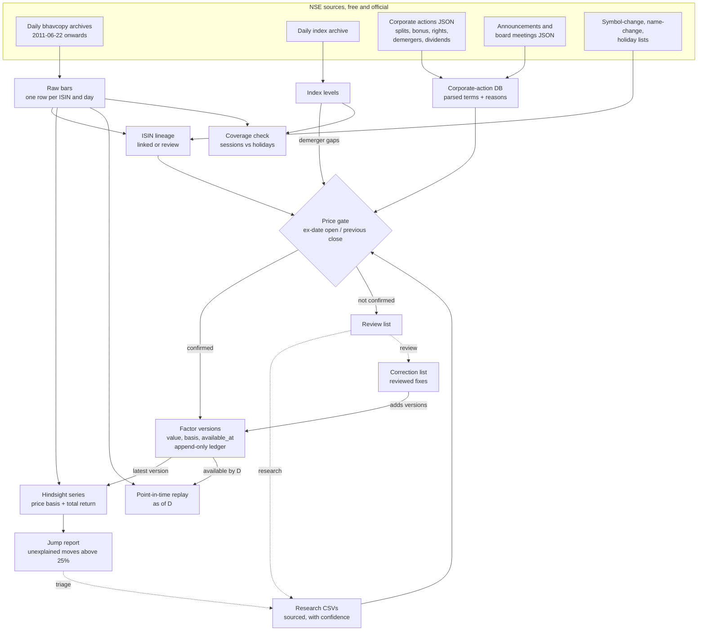

# NSE-noodles

**The method, not the data:** scripts and rules to build a clean, survivorship-bias-free daily
dataset of the National Stock Exchange of India (NSE) from NSE's own free sources, with every
corporate-action factor checked against the prices before it is used.

> **Data notice.** All market data belongs to NSE (and, for filings, to the companies). This
> repository contains **no data**: no prices, no corporate-action rows, no research results.
> The scripts download from NSE's public archives and website endpoints to a folder on your
> machine. Those website endpoints are not a documented public API. Respect NSE's terms of use
> and rate limits: the default pace is one request every 2 seconds, never run two pulls at once,
> and do not redistribute what you download.

**Two series, for two jobs.** `out/hindsight_daily.parquet` applies every factor at its latest
version to all earlier bars, including factors that became known only days or weeks after the
ex-date: use it for research on what happened, never to make a backtest's decisions.
`build replay --as-of D` writes `out/replay_daily_asof=D.parquet`, the series as it could have
been built after day D: bars up to D and only factor versions whose `available_at` is on or
before D (a version with unknown availability never qualifies). **Backtests compute day D's
signals from the replay as of D.** Raw prices stay untouched in `bars/` and beside the adjusted
columns. See [Point in time](#point-in-time).

## Why

Two silent errors ruin most home-made Indian equity backtests:

1. **Unadjusted corporate actions create false signals.** A 1:1 bonus halves the share price
   overnight. In an unadjusted series that is a 50% crash: stops trigger, breakdown and
   momentum signals fire, a 52-week low appears. Demergers (TATAMOTORS 2025, VEDL 2026), rights
   issues, face-value splits, ETF unit splits and bonus debentures do the same at smaller or
   larger scale. Dividends shave a few percent on ex-dates, which a total-return signal must
   not read as weakness, while P&L must still be computed from real prices plus the cash.
2. **Survivorship bias.** Building a universe from today's listed symbols drops every company
   that was delisted, merged away or went bust, which inflates returns. Symbols also change:
   joining histories by symbol silently splices two different companies or cuts one company's
   history in two when its ISIN changes.

NSE-noodles keys everything by ISIN, keeps every security that ever appeared in a daily
bhavcopy, joins ISIN changes of the same shares only on evidence, and accepts a corporate-action
factor only when the ex-date price gap confirms it. Whatever it cannot confirm goes to a review
list with a reason, never into the series.

## Pipeline



## Sources

| Source | What | Endpoint |
|---|---|---|
| CM bhavcopy (old format, to 5 Jul 2024) | Daily OHLC, volume, value, PREVCLOSE, ISIN | `nsearchives.nseindia.com/content/historical/EQUITIES/YYYY/MON/cmDDMONYYYYbhav.csv.zip` |
| CM bhavcopy (UDiFF, from 8 Jul 2024) | Same, new layout | `nsearchives.nseindia.com/content/cm/BhavCopy_NSE_CM_0_0_0_YYYYMMDD_F_0000.csv.zip` |
| Index archive | OHLC of every NSE index | `nsearchives.nseindia.com/content/indices/ind_close_all_DDMMYYYY.csv` |
| Corporate actions | Purpose text, ex/record date, face value (dividends included) | `www.nseindia.com/api/corporates-corporateActions` |
| Announcements | Filings with attachment text and links | `www.nseindia.com/api/corporate-announcements` |
| Board meetings | Intimations and purposes | `www.nseindia.com/api/corporate-board-meetings` |
| Symbol / name changes | Old and new symbol or name, effective date | `nsearchives.nseindia.com/content/equities/symbolchange.csv`, `namechange.csv` |
| Holidays | The current year's trading holidays | `www.nseindia.com/api/holiday-master?type=trading` |

The JSON endpoints answer only a browser-like session: the client loads the home page first
(for cookies) and sends a browser User-Agent and Referer. Requests are paced (2 s), retried
(5 tries, backing off, with a fresh session after two failures), and written in monthly shards
so an interrupted pull resumes.

## Quick start

Python 3.12+.

```bash
git clone https://github.com/abhij1306/NSE-noodles && cd NSE-noodles
uv venv && uv pip install -e ".[dev]"        # or: python -m venv .venv && pip install -e ".[dev]"

# a small try: two weeks of prices, one month of corporate actions
noodles --data ~/nse-data pull bhavcopy --from 2026-10-01 --to 2026-10-23
noodles --data ~/nse-data build bars
noodles --data ~/nse-data pull indices  --from 2026-10-01 --to 2026-10-23
noodles --data ~/nse-data pull nse --dataset corporate_actions --from 2026-09-01 --to 2026-10-23
noodles --data ~/nse-data pull lists
for s in bars ca-db actions hindsight reports; do noodles --data ~/nse-data build $s; done
noodles --data ~/nse-data build replay --as-of 2026-10-15   # a point-in-time replay

# the full history, everything in order (resumable; rerun after any interruption)
noodles --data ~/nse-data run --from 2011-06-22
```

Keep `--data` outside any git repository. At the default pace the full history takes several
hours (about 3,900 bhavcopy files plus as many index files at one request per 2 s, and about
380 monthly corporate-action requests for equities and SME). Announcements and board meetings
(`pull nse --dataset announcements board_meetings`, or `run --with-announcements`) are optional;
they add instrument-class evidence for bonuses and date each event's first notice
(`announced_on`).

Weekend special sessions (Budget Saturdays, Muhurat Sundays) are fetched with
`pull bhavcopy --extra-days YYYY-MM-DD ...`.

## Outputs

Under `--data`:

| Path | What |
|---|---|
| `raw/` | Untouched downloads (zips, CSVs, JSON shards) and `not_found.json` (archive 404s) |
| `ledger/factor_versions.jsonl` | Every factor version ever produced, appended, never rewritten: the only record of `first_observed_at`. Keep it with `raw/`; nothing rebuilds it |
| `bars/date=YYYY-MM-DD.parquet` | Raw bars: `date, isin, symbol, series, open, high, low, close, prev_close, volume, traded_value` (one row per ISIN; EQ, then BE, BZ, then block windows) |
| `index/date=YYYY-MM-DD.parquet` | `date, index_name, open, high, low, close` |
| `out/hindsight_daily.parquet` | HINDSIGHT: every raw bar plus `chain_isin` (the company's current ISIN), `price_factor`, `div_factor`, `adj_open/high/low/close` (price basis), `adj_volume`, `tr_close` (total return), `ordinary_equity`, `factor_pending` (see [Point in time](#point-in-time)) |
| `out/replay_daily_asof=D.parquet`, `out/replay_instruments_asof=D.parquet` | POINT-IN-TIME: the same columns, as they could have been built after day D (`build replay --as-of D`) |
| `out/instruments.parquet` | Per chain: `isins, symbols, last_symbol, first_day, last_day, ordinary_equity, stopped_trading` |
| `out/jumps.csv` | Unexplained adjusted moves above 25%: `chain_isin, isin, symbol, previous_day, date, previous_close, adj_open, ratio, security, feed_near, review_near` |
| `out/review.csv` | Everything waiting for a human: corporate-action rows and ISIN successions, with reason and evidence |
| `out/adjustment_log.csv` | Every event at its hindsight version: `symbol, action_type, version, factor, cash, basis, method, source, announced_on, notice_url, ex_date, source_published_at, first_observed_at, available_at, available_basis, lag_sessions` |
| `out/factor_versions.csv` | Every version of every event: `version, status, value, cash, basis, raw_gap, band_low, band_high`, the three timestamps, `available_basis`, `version_id` |
| `out/coverage.json` | Weekdays by bucket (`holiday, gap, unaccounted, on_listed_holiday, weekend_session`) and `index_missing` |
| `noodles.duckdb` | All tables below |

Tables in `noodles.duckdb`:

| Table | Columns (main) |
|---|---|
| `ca_feed` | `symbol, company, series, isin, subject, ex_date, record_date, face_value, market` |
| `splits_bonus` | feed columns + `legs` (`bonus=1/2;split=1/5`), `parse_status`, `instrument_class`, `classification_source`, `evidence`, `evidence_url` |
| `rights_issues` | feed columns + `ratio_new, ratio_held, issue_price, parse_status` |
| `demergers`, `bonus_instruments` | feed columns (ratios and values come from research) |
| `dividends` | `isin, symbol, ex_date, amount, kinds, status, subjects` (one row per ISIN and ex-date) |
| `announcements`, `board_meetings` | as NSE gives them (when pulled) |
| `lineage` | `old_isin, new_isin, effective, status (linked/review), reason, evidence, known_on` (the new ISIN's first day + 10 days: the window the link rules read) |
| `chain_map` | `isin, chain_isin, depth` |
| `factor_versions` | Every version: `version_id, chain_isin, isin, symbol, ex_date, action_type, version, status (accepted/disputed), value, cash, basis, raw_gap, band_low, band_high, method, source, text, evidence, announced_on, notice_url, source_published_at, first_observed_at, available_at, available_basis` |
| `actions` | The hindsight choice: per event, its accepted version of highest precedence (same columns) |
| `review`, `skipped` | `table, symbol, isin, ex_date, reason, text, hint, evidence` |
| `corrections_log` | What each correction line did |

Use the **price basis** (`adj_*`) for fills, stops and P&L, crediting `cash` from `actions` on
ex-dates to shares held into them. Use **`tr_close`** for signals. Use raw `close` for any rule
on an absolute rupee price (minimum price, tick size).

### Point in time

A factor is a set of **versions**, never overwritten. An event (chain, ex-date, type) gets a
version when a value is first accepted, another when a later observation prices it (a
demerger's ratio once the resulting company trades), and one per correction line (a deletion is
a version of value 1). Each version carries three times (India Standard Time):

| Time | Meaning |
|---|---|
| `source_published_at` | When the source of its terms was published: the research row's `source_date`, the correction's `known_on`, or the first NSE filing found for the event (`announced_on`). Empty = unknown |
| `first_observed_at` | When this pipeline first produced the version (from the ledger). A history built today is first observed today: a replay is a reconstruction, not a record of what was seen live |
| `available_at` | The earliest time the value and the rule that accepts it could have been known: the latest of every price and source it reads. **Empty = unknown, and then it never enters a replay.** A date-only source counts from the end of its day; no time is ever moved earlier than its evidence |

| `available_basis` | `available_at` |
|---|---|
| `ex_open` | the ex-date open, stamped 10:00 (NSE's special pre-open for restructured F&O stocks sets the open by 09:55; other stocks open at 09:15): splits, bonuses and rights confirmed by the gap, TERP, dividends. The feed's terms predate the ex-date (an ex-date exists only once the company has notified its record date), so the open is the binding time |
| `settled_close` | 16:00 on the session `SETTLE_SESSIONS` (5) from the ex-date: a demerger gap accepted because it held |
| `resulting_first_close` | 16:00 on the resulting company's first session (not before the research source date): a ratio-priced demerger version, or a gap accepted because the ratio agreed |
| `research_source_date` | end of the research row's `source_date`, never before the price the decision read |
| `correction` | end of the correction line's `known_on` |
| `research_undated`, `correction_undated` | unknown (empty) |

**Hindsight** (`build hindsight`, `out/hindsight_daily.parquet`) uses each event's accepted
version of highest precedence (later versions and corrections win), whatever its availability,
and flags with `factor_pending` the bars from an ex-date until the event's first version was
available (all of them when none has a known time): there the series shows no gap that a trader
then would have seen.

**Point-in-time replay** (`build replay --as-of D`) uses bars up to D, per event the accepted
version of highest precedence with `available_at` by the end of D and an ex-date on or before D,
and only the ISIN links known by D. Adding a version that becomes available after D cannot
change the replay as of D (`tests/test_point_in_time.py`). For a backtest, compute day D's
signals from the replay as of D (replay the dates your signals need).

On the Sep-Oct 2026 window, HEG went ex-demerger on 7 Sep (previous close 728.25, ex open
260.00, raw gap 0.3570; the NIFTY 500 moved −0.03% that night, so the neutralised gap is
0.3571). With no resulting-company price yet, the gap was accepted because it held five sessions
later: `available_at 2026-09-11 16:00, available_basis settled_close`. The replay as of 10 Sep
leaves HEG unadjusted (the raw 64% gap shows); as of 11 Sep it applies 0.3571 to every earlier
bar. The hindsight series applies it throughout and flags 7-10 Sep `factor_pending`.

ISIN successions follow the same rule: `lineage.known_on` is the new ISIN's first day plus the
10 days of bars the link rules read, so a build stopped inside that window never dates the link
earlier.

### Demergers

NSE's feed never gives a demerger's factor. The parent's ex-date open (set in NSE's special
pre-open for F&O stocks, the regular pre-open otherwise) is the market's price of what is left,
but the gap ex open / previous close also holds the whole market's move that night. So:

1. **Ex-date version** (`basis index_neutral_gap`): the gap divided by the NIFTY 500's own
   overnight move (its open over its previous close). NIFTY 500 because it is the broadest NSE
   index in the daily archive for the whole index history (from 2012); a sector index would need
   a point-in-time stock-to-sector map that NSE's free archives do not give. Before the index
   history, or on a missing index day, the version is the raw gap (`basis raw_gap`). The raw gap
   is always kept (`raw_gap`). The version is accepted when a cross-check agrees (the research
   ratio priced at the resulting company's first close, or the company's cost-of-acquisition %),
   or, with none, when the drop is at least 10% and the neutralised close five sessions later
   still agrees.
2. **Ratio version** (`basis resulting_ratio`): once every resulting company has traded,
   1 − Σ rᵢ·Cᵢ / P, with Cᵢ its first close brought back to the ex-date's market level by the
   index, available from that close. More than 10% (in log terms) from the ex-date version, it is
   recorded `disputed`, never used, and the event goes to review (`demerger_versions_disagree`).
3. Each version records a band (`band_low`, `band_high`): the range of the estimates known for it
   (raw gap, neutralised gap, ratio-priced value).

What this cannot remove: news about the company itself that morning (results, the market's view
of the new structure, order imbalance in a thin pre-open) moves every open-based estimate alike,
so it is neither removed nor inside the band. The neutralisation assumes a beta of 1 to the broad
market and ignores the stock's sector; for an F&O stock the index open (09:15) comes about 40
minutes before the special pre-open sets the stock's open. The ratio version carries the
resulting company's own listing pricing. The band is a spread of estimates, not a confidence
interval.

## Review lists

| Reason | Meaning | What to do |
|---|---|---|
| `off_factor` | The ex-date gap is more than 20% away from the factor | Wrong ratio, wrong date, or the action was not of equity: research |
| `ambiguous` | The gap is as close to 1 as to the factor (a small factor) | Research the terms; often a public-only bonus |
| `no_bars` / `no_instrument` | No price on one side of the ex-date, or no ISIN/symbol match | Check suspension, symbol change, SME |
| `unparsed`, `no_issue_price`, `non_simple` | The text cannot be priced (partly paid, warrants, no premium) | Research the letter of offer |
| `needs_research:*` | A demerger with no ratio/CoA cross-check whose gap alone is not enough | Research the scheme: ratio, resulting company, CoA |
| `gap_disagrees_*`, `no_cross_check_*` | A demerger gap not accepted: date unconfirmed, drop under 10%, or not held five sessions on | Research; correct by hand if confirmed |
| `demerger_versions_disagree` | The ratio-priced factor is more than 10% from the ex-date gap; the gap version stays, the ratio version is `disputed` | Check the ratio, the resulting company and its first session |
| `low_confidence`, `date_disputed` | Research is weak or names another date | More sources |
| `research_says_row_wrong` | A research row marks NSE's row itself wrong (`our_data_wrong = yes`); its terms are not used | A correction line (`delete`, `move` or `add`) |
| `needs_value` | A bonus of debentures/preference shares without a researched value | Research the value per share |
| `amount_vs_price`, `percent_of_face_value`, `rows_disagree`, ... | A dividend that cannot be trusted as written | Check the filing |
| Lineage `price_jump`, `prev_close_mismatch`, `long_gap`, `restructuring`, `ambiguous` | An ISIN succession the rules could not prove | Link or unlink in `lineage_overrides.tsv` after checking |

`out/jumps.csv` is the final check: after the pipeline, every jump is either a factor still to
fix or a genuine move to note (a huge special dividend, a tick-size artefact, an insolvency
relisting). Rights-entitlement instruments (`-RE`, ISIN security type `20`) and fund units
(`INF`) jump by design and are labelled in the `security` column.

## Curation (the human part)

A curation folder (default `DATA/curation/`, or `--curation DIR`) holds what people and agents
add. It is input, never output, and is re-applied on every rebuild.

- `research/*.csv`: sourced research rows (columns in `nse_noodles/curation.py:RESEARCH_COLUMNS`).
  For example, a demerger leg:
  ```csv
  table,symbol,isin,ex_date,leg_type,resulting_name,resulting_symbol,resulting_isin,ratio_a,ratio_b,issue_price,face_value,partly_paid,coa_parent_pct,coa_resulting_pct,non_equity_consideration,value_per_share_rs,record_date,our_data_wrong,confidence,source_url,source_date,quote,notes
  demerger,PARENT,INE000X01011,2025-01-06,demerger,Child Ltd,CHILD,INE000Y01019,1,10,,,,,,,,2025-01-06,no,high,https://example.com/filing.pdf,2024-11-20,"1 equity share of Child for every 10 shares of Parent",
  ```
  `source_date` is when the source was published. A value taken from an undated row has no
  `available_at` and never enters a replay; never write a date earlier than the source shows.
  Change research by adding rows: an edited or removed row withdraws its versions from the build
  (the ledger keeps them; the build counts them as `withdrawn_from_ledger`).
- `corrections.tsv`: reviewed fixes, `op isin ex_date type value new_ex_date note [known_on]`
  (tab-separated; `op` is add / replace / delete / move; `value` is the factor, or rupees per
  share for `dividend`; a `split` factor is new face value / old, so a consolidation is above
  1; `known_on` is when the corrected value was public). Each line adds a version and never
  edits one, so a replay before `known_on` keeps what was believed then; a line without
  `known_on` reaches the hindsight series only. Every line needs a note with its evidence:
  ```tsv
  add	INE000X01011	2019-12-19	split	0.1		NSE circular: unit face value 10 -> 1; gap 0.1003	2019-12-10
  ```
- `lineage_overrides.tsv`: `op old_isin new_isin note`, op link / unlink.
- `holidays.txt`: past NSE trading holidays, one ISO date per line. NSE publishes only the
  current year's list; build past years from NSE's yearly holiday circulars, or from a holiday
  calendar package, and check them against the archive (a weekday NSE has no file for).

## Agent skills

`.claude/skills/` holds three skills for Claude Code (or any agent that reads `SKILL.md`):

- `build-dataset`: run the pipeline end to end, read the counts, decide what to rerun.
- `research-corporate-action`: verify a ratio, issue price or ex-date from primary sources and
  write one sourced research row with a confidence.
- `triage-jumps`: classify each unexplained jump as a missing factor or a genuine move and turn
  findings into research rows or correction lines.

## Honest limits

- **NSE's labels are unreliable.** The feed's instrument class (equity / preference /
  debentures) is often missing or wrong; bonus debentures appear as plain "Bonus 1:1". The bars
  decide, and the class is only a hint.
- **History starts 22 Jun 2011** (the first bhavcopy with ISINs). Before about 2011-2012 the
  corporate-action feed is thinner, demerger ratios are rarely findable in filings, the index
  archive starts in 2012 (VIX 2014, Smallcap 250 2019), and NSE's SME feed has nothing before
  Aug 2017.
- **Rights and demergers need research.** The feed never carries a demerger ratio and often
  lacks the rights issue price. Resolving them takes a person or an agent reading filings; the
  pipeline only verifies and stores what research finds.
- **ETF unit splits** are not in the corporate-action feed; they show up as jumps and are fixed
  from NSE circulars through the correction list.
- **Demerger factors are market estimates.** The index-neutralised gap removes the market's
  move that night, not the stock's own news; see [Demergers](#demergers).
- **Hindsight is the default output.** Use the replay for anything point in time. Feed rows
  carry no publication time of their own (NSE's broadcast date is mostly empty), so their
  versions' `available_at` rests on the ex-date open; `announced_on` is only as good as the
  announcements pulled; research and corrections without a source date never enter a replay
  rather than being dated by guess. A replay of a history built today is a reconstruction
  (`first_observed_at` says when the pipeline first saw each version). A link can become a
  review case when a competing successor appears up to 30 sessions later; a replay of the full
  build then lacks a link that a build stopped earlier had.
- **No pay dates.** Dividend cash is credited on the ex-date.
- The website JSON endpoints can change or block automated access at any time.

## Development

```bash
uv pip install -e ".[dev]"
ruff check . && ruff format --check .
pytest -q                     # pure functions only: factor maths, TERP, parsers, version selection
```

The rules are in [docs/method.md](docs/method.md). Code is MIT-licensed (see `LICENSE`); the
data you download stays NSE's.
