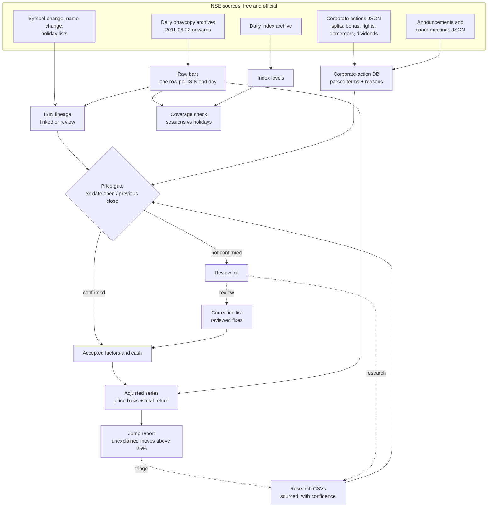

# NSE-noodles

**The method, not the data:** scripts and rules to build a clean, survivorship-bias-free daily
dataset of the National Stock Exchange of India (NSE) from NSE's own free sources, with every
corporate-action factor checked against the prices before it is used.

> **Data notice.** All market data belongs to NSE (and, for filings, to the companies). This
> repository contains **no data**: no prices, no corporate-action rows, no research results.
> The scripts download from NSE's public archives and website endpoints to a folder on your
> machine. Those website endpoints are not a documented public API. Respect NSE's terms of use
> and rate limits: the default pace is one request every 2 seconds, never run two pulls at once,
> and do not redistribute what you download.

## Why

Two silent errors ruin most home-made Indian equity backtests:

1. **Unadjusted corporate actions create false signals.** A 1:1 bonus halves the share price
   overnight. In an unadjusted series that is a 50% crash: stops trigger, breakdown and
   momentum signals fire, a 52-week low appears. Demergers (TATAMOTORS 2025, VEDL 2026), rights
   issues, face-value splits, ETF unit splits and bonus debentures do the same at smaller or
   larger scale. Dividends shave a few percent on ex-dates, which a total-return signal must
   not read as weakness, while P&L must still be computed from real prices plus the cash.
2. **Survivorship bias.** Building a universe from today's listed symbols drops every company
   that was delisted, merged away or went bust, which inflates returns. Symbols also change:
   joining histories by symbol silently splices two different companies or cuts one company's
   history in two when its ISIN changes.

NSE-noodles keys everything by ISIN, keeps every security that ever appeared in a daily
bhavcopy, joins ISIN changes of the same shares only on evidence, and accepts a corporate-action
factor only when the ex-date price gap confirms it. Whatever it cannot confirm goes to a review
list with a reason, never into the series.

## Pipeline



## Sources

| Source | What | Endpoint |
|---|---|---|
| CM bhavcopy (old format, to 5 Jul 2024) | Daily OHLC, volume, value, PREVCLOSE, ISIN | `nsearchives.nseindia.com/content/historical/EQUITIES/YYYY/MON/cmDDMONYYYYbhav.csv.zip` |
| CM bhavcopy (UDiFF, from 8 Jul 2024) | Same, new layout | `nsearchives.nseindia.com/content/cm/BhavCopy_NSE_CM_0_0_0_YYYYMMDD_F_0000.csv.zip` |
| Index archive | OHLC of every NSE index | `nsearchives.nseindia.com/content/indices/ind_close_all_DDMMYYYY.csv` |
| Corporate actions | Purpose text, ex/record date, face value (dividends included) | `www.nseindia.com/api/corporates-corporateActions` |
| Announcements | Filings with attachment text and links | `www.nseindia.com/api/corporate-announcements` |
| Board meetings | Intimations and purposes | `www.nseindia.com/api/corporate-board-meetings` |
| Symbol / name changes | Old and new symbol or name, effective date | `nsearchives.nseindia.com/content/equities/symbolchange.csv`, `namechange.csv` |
| Holidays | The current year's trading holidays | `www.nseindia.com/api/holiday-master?type=trading` |

The JSON endpoints answer only a browser-like session: the client loads the home page first
(for cookies) and sends a browser User-Agent and Referer. Requests are paced (2 s), retried
(5 tries, backing off, with a fresh session after two failures), and written in monthly shards
so an interrupted pull resumes.

## Quick start

Python 3.12+.

```bash
git clone https://github.com/abhij1306/NSE-noodles && cd NSE-noodles
uv venv && uv pip install -e ".[dev]"        # or: python -m venv .venv && pip install -e ".[dev]"

# a small try: two weeks of prices, one month of corporate actions
noodles --data ~/nse-data pull bhavcopy --from 2026-10-01 --to 2026-10-23
noodles --data ~/nse-data build bars
noodles --data ~/nse-data pull indices  --from 2026-10-01 --to 2026-10-23
noodles --data ~/nse-data pull nse --dataset corporate_actions --from 2026-09-01 --to 2026-10-23
noodles --data ~/nse-data pull lists
for s in bars ca-db actions adjusted reports; do noodles --data ~/nse-data build $s; done

# the full history, everything in order (resumable; rerun after any interruption)
noodles --data ~/nse-data run --from 2011-06-22
```

Keep `--data` outside any git repository. At the default pace the full history takes several
hours (about 3,900 bhavcopy files plus as many index files at one request per 2 s, and about
380 monthly corporate-action requests for equities and SME). Announcements (`pull nse --dataset
announcements`, weekly requests) are optional; they add instrument-class evidence for bonuses.

Weekend special sessions (Budget Saturdays, Muhurat Sundays) are fetched with
`pull bhavcopy --extra-days YYYY-MM-DD ...`.

## Outputs

Under `--data`:

| Path | What |
|---|---|
| `raw/` | Untouched downloads (zips, CSVs, JSON shards) and `not_found.json` (archive 404s) |
| `bars/date=YYYY-MM-DD.parquet` | Raw bars: `date, isin, symbol, series, open, high, low, close, prev_close, volume, traded_value` (one row per ISIN; EQ, then BE, BZ, then block windows) |
| `index/date=YYYY-MM-DD.parquet` | `date, index_name, open, high, low, close` |
| `out/adjusted_daily.parquet` | Every raw bar plus `chain_isin` (the company's current ISIN), `price_factor`, `div_factor`, `adj_open/high/low/close` (price basis), `adj_volume`, `tr_close` (total return), `ordinary_equity` |
| `out/instruments.parquet` | Per chain: `isins, symbols, last_symbol, first_day, last_day, ordinary_equity, stopped_trading` |
| `out/jumps.csv` | Unexplained adjusted moves above 25%: `chain_isin, isin, symbol, previous_day, date, previous_close, adj_open, ratio, security, feed_near, review_near` |
| `out/review.csv` | Everything waiting for a human: corporate-action rows and ISIN successions, with reason and evidence |
| `out/coverage.json` | Weekdays by bucket (`holiday, gap, unaccounted, on_listed_holiday, weekend_session`) and `index_missing` |
| `noodles.duckdb` | All tables below |

Tables in `noodles.duckdb`:

| Table | Columns (main) |
|---|---|
| `ca_feed` | `symbol, company, series, isin, subject, ex_date, record_date, face_value, market` |
| `splits_bonus` | feed columns + `legs` (`bonus=1/2;split=1/5`), `parse_status`, `instrument_class`, `classification_source`, `evidence`, `evidence_url` |
| `rights_issues` | feed columns + `ratio_new, ratio_held, issue_price, parse_status` |
| `demergers`, `bonus_instruments` | feed columns (ratios and values come from research) |
| `dividends` | `isin, symbol, ex_date, amount, kinds, status, subjects` (one row per ISIN and ex-date) |
| `announcements`, `board_meetings` | as NSE gives them (when pulled) |
| `lineage` | `old_isin, new_isin, effective, status (linked/review), reason, evidence` |
| `chain_map` | `isin, chain_isin, depth` |
| `actions` | Accepted: `chain_isin, isin, symbol, ex_date, action_type, factor, cash, method, source, text, evidence` |
| `review`, `skipped` | `table, symbol, isin, ex_date, reason, text, hint, evidence` |
| `corrections_log` | What each correction line did |

Use the **price basis** (`adj_*`) for fills, stops and P&L, crediting `cash` from `actions` on
ex-dates to shares held into them. Use **`tr_close`** for signals. Use raw `close` for any rule
on an absolute rupee price (minimum price, tick size).

## Review lists

| Reason | Meaning | What to do |
|---|---|---|
| `off_factor` | The ex-date gap is more than 20% away from the factor | Wrong ratio, wrong date, or the action was not of equity: research |
| `ambiguous` | The gap is as close to 1 as to the factor (a small factor) | Research the terms; often a public-only bonus |
| `no_bars` / `no_instrument` | No price on one side of the ex-date, or no ISIN/symbol match | Check suspension, symbol change, SME |
| `unparsed`, `no_issue_price`, `non_simple` | The text cannot be priced (partly paid, warrants, no premium) | Research the letter of offer |
| `needs_research:*` | A demerger with no ratio/CoA cross-check whose gap alone is not enough | Research the scheme: ratio, resulting company, CoA |
| `gap_disagrees_*`, `no_cross_check_*` | A demerger gap not accepted: date unconfirmed, drop under 10%, or not held five sessions on | Research; correct by hand if confirmed |
| `low_confidence`, `date_disputed` | Research is weak or names another date | More sources |
| `needs_value` | A bonus of debentures/preference shares without a researched value | Research the value per share |
| `amount_vs_price`, `percent_of_face_value`, `rows_disagree`, ... | A dividend that cannot be trusted as written | Check the filing |
| Lineage `price_jump`, `prev_close_mismatch`, `long_gap`, `restructuring`, `ambiguous` | An ISIN succession the rules could not prove | Link or unlink in `lineage_overrides.tsv` after checking |

`out/jumps.csv` is the final check: after the pipeline, every jump is either a factor still to
fix or a genuine move to note (a huge special dividend, a tick-size artefact, an insolvency
relisting). Rights-entitlement instruments (`-RE`, ISIN security type `20`) and fund units
(`INF`) jump by design and are labelled in the `security` column.

## Curation (the human part)

A curation folder (default `DATA/curation/`, or `--curation DIR`) holds what people and agents
add. It is input, never output, and is re-applied on every rebuild.

- `research/*.csv`: sourced research rows (columns in `nse_noodles/curation.py:RESEARCH_COLUMNS`).
  For example, a demerger leg:
  ```csv
  table,symbol,isin,ex_date,leg_type,resulting_name,resulting_symbol,resulting_isin,ratio_a,ratio_b,issue_price,face_value,partly_paid,coa_parent_pct,coa_resulting_pct,non_equity_consideration,value_per_share_rs,record_date,our_data_wrong,confidence,source_url,quote,notes
  demerger,PARENT,INE000X01011,2025-01-06,demerger,Child Ltd,CHILD,INE000Y01019,1,10,,,,,,,,2025-01-06,no,high,https://example.com/filing.pdf,"1 equity share of Child for every 10 shares of Parent",
  ```
- `corrections.tsv`: reviewed fixes, `op isin ex_date type value new_ex_date note` (tab-separated;
  `op` is add / replace / delete / move; `value` is the factor, or rupees per share for
  `dividend`). Every line needs a note with its evidence:
  ```tsv
  add	INE000X01011	2019-12-19	split	0.1		NSE circular: unit face value 10 -> 1; gap 0.1003
  ```
- `lineage_overrides.tsv`: `op old_isin new_isin note`, op link / unlink.
- `holidays.txt`: past NSE trading holidays, one ISO date per line. NSE publishes only the
  current year's list; build past years from NSE's yearly holiday circulars, or from a holiday
  calendar package, and check them against the archive (a weekday NSE has no file for).

## Agent skills

`.claude/skills/` holds three skills for Claude Code (or any agent that reads `SKILL.md`):

- `build-dataset`: run the pipeline end to end, read the counts, decide what to rerun.
- `research-corporate-action`: verify a ratio, issue price or ex-date from primary sources and
  write one sourced research row with a confidence.
- `triage-jumps`: classify each unexplained jump as a missing factor or a genuine move and turn
  findings into research rows or correction lines.

## Honest limits

- **NSE's labels are unreliable.** The feed's instrument class (equity / preference /
  debentures) is often missing or wrong; bonus debentures appear as plain "Bonus 1:1". The bars
  decide, and the class is only a hint.
- **History starts 22 Jun 2011** (the first bhavcopy with ISINs). Before about 2011-2012 the
  corporate-action feed is thinner, demerger ratios are rarely findable in filings, the index
  archive starts in 2012 (VIX 2014, Smallcap 250 2019), and NSE's SME feed has nothing before
  Aug 2017.
- **Rights and demergers need research.** The feed never carries a demerger ratio and often
  lacks the rights issue price. Resolving them takes a person or an agent reading filings; the
  pipeline only verifies and stores what research finds.
- **ETF unit splits** are not in the corporate-action feed; they show up as jumps and are fixed
  from NSE circulars through the correction list.
- **Market-gap demerger factors** carry about a day of noise: the special pre-open price is
  the market's estimate, not an accounting value.
- **No pay dates.** Dividend cash is credited on the ex-date.
- The website JSON endpoints can change or block automated access at any time.

## Development

```bash
uv pip install -e ".[dev]"
ruff check . && ruff format --check .
pytest -q                     # pure-function tests only: factor maths, TERP, parsers
```

The rules are in [docs/method.md](docs/method.md). Code is MIT-licensed (see `LICENSE`); the
data you download stays NSE's.
