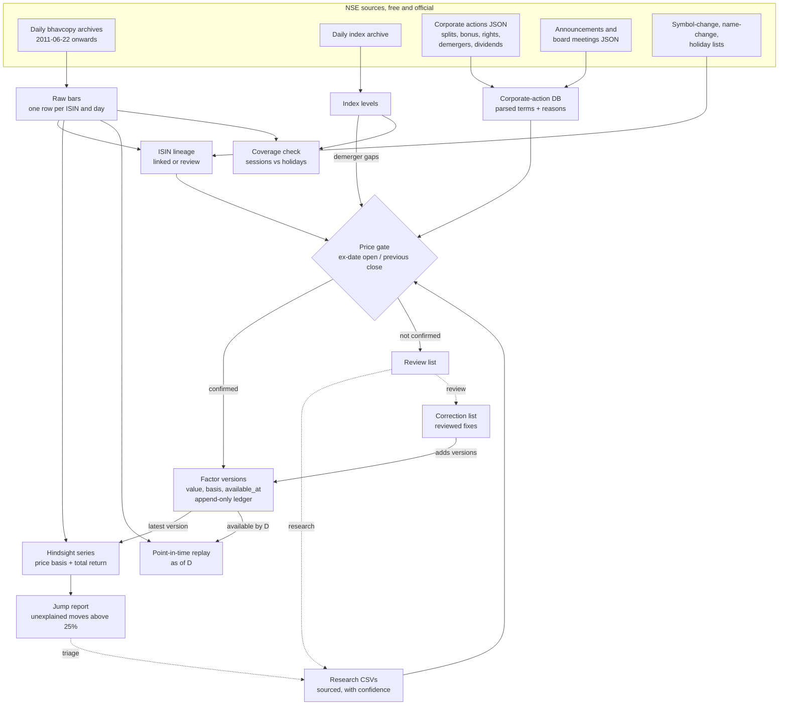

# Method: invariants and rules

The rules the code keeps, each stated once. The code is the source of truth: if this file and
the code disagree, one of them is wrong. Terms are in the [glossary](glossary.md). How to use
the outputs in a backtest is in [backtesting](backtesting.md).

## Pipeline

## Sources

1. Only official, free NSE sources:

   | Source | What | Endpoint |
   |---|---|---|
   | CM bhavcopy, old format (to 5 Jul 2024) | Daily OHLC, volume, value, PREVCLOSE, ISIN | `nsearchives.nseindia.com/content/historical/EQUITIES/YYYY/MON/cmDDMONYYYYbhav.csv.zip` |
   | CM bhavcopy, UDiFF (from 8 Jul 2024) | The same, new layout | `nsearchives.nseindia.com/content/cm/BhavCopy_NSE_CM_0_0_0_YYYYMMDD_F_0000.csv.zip` |
   | Index archive | OHLC of every NSE index | `nsearchives.nseindia.com/content/indices/ind_close_all_DDMMYYYY.csv` |
   | Corporate actions | Purpose text, ex/record date, face value (dividends included) | `www.nseindia.com/api/corporates-corporateActions` |
   | Announcements | Filings with attachment text and links | `www.nseindia.com/api/corporate-announcements` |
   | Board meetings | Intimations and purposes | `www.nseindia.com/api/corporate-board-meetings` |
   | Symbol / name changes | Old and new symbol or name, effective date | `nsearchives.nseindia.com/content/equities/symbolchange.csv`, `namechange.csv` |
   | Holidays | The current year's trading holidays | `www.nseindia.com/api/holiday-master?type=trading` |

   The `www.nseindia.com/api` endpoints are not a documented public API and can change or block
   automated access. Research may read company filings, BSE/NSE filings and reputable news,
   always quoted.
2. The data belongs to NSE. Nothing pulled is committed or redistributed. Requests are paced
   (one every 2 s by default), one pull at a time, following NSE's terms.
3. Raw downloads are kept untouched and never rewritten. Everything else is rebuilt from them,
   except the append-only factor ledger (rule 32), which records when each version was first
   observed.

## Identity and survivorship

4. A security is its ISIN, not its symbol. Symbols change; the ISIN of a given share does not
   (until a reissue, see lineage).
5. The history starts on 22 Jun 2011, the first bhavcopy with an ISIN column.
6. The bars keep the equity series `EQ`, `BE`, `BZ` and the block/institutional windows `BL`,
   `BT`, `IL`, `IQ`, one row per ISIN and day: `EQ` first, then `BE`, `BZ`, then the others.
   Debt, SME and other series are left out. A row with a non-positive price, or a high and low
   that do not bracket the open and close, is counted and left out, never repaired. A zip with
   no valid row fails the bars build.
7. Nothing is filtered by today's listing. Every equity-series security in each day's file is
   kept, so delisted, suspended and merged-away companies stay in the history
   (survivorship-bias free). A chain whose last bar is more than 20 sessions before the data's
   last session stopped trading.
8. "Ordinary equity" is read from the ISIN (`IN` + `E`/`9` + issuer + security type `01`),
   never from a label. NSE's instrument-class labels are unreliable: treat them as hints.

## ISIN lineage

9. A new ISIN for the same shares (face-value change, reissue, symbol or name change) is linked
   to the old one only when all rules hold:
   - the new ISIN's first session follows the old one's last within 5 sessions, with no
     overlap;
   - neither ISIN has another candidate;
   - the same symbol, or an NSE symbol-change record within 7 days of the change;
   - the new first PREVCLOSE equals the old last close (raw or factor-adjusted) within 1%;
   - the new first open is within 10% of it;
   - no session move over 25% in the 10 calendar days of bars at either edge, unexplained by a
     known factor;
   - no corporate action of either ISIN within 30 days that names a demerger, amalgamation,
     merger, arrangement or capital reduction.

   Pairs further than 30 sessions apart are not candidates at all.
10. Anything else is a review case, never a link. A false link is worse than a missing one.
11. Demergers, mergers, schemes and relistings keep separate histories. A demerged company is
    a new listing; the parent is adjusted by a factor, never linked to it.
12. An owner verdict (`link` / `unlink`) on a found candidate overrules the rules and survives
    every rebuild. A rules link sharing an ISIN with an owner link becomes a review case. An
    owner link on a pair that is not a candidate cannot be applied (`override_unused`).

## Factors

13. A price factor multiplies every price before the ex-date and lies in (0, 1), except a
    consolidation (reverse split, added by correction), whose factor is above 1. Adjusted price
    = raw × the product of the factors with an ex-date after the bar's date, applied once per
    chain. Volume is divided by the same factor.
14. Split: new face value / old. Bonus x:y: y / (x + y). Bonus + split in one purpose: both legs.
15. Rights M:N at issue price S (face value + premium), cum price P = previous close:
    TERP / P = (N·P + M·S) / ((N+M)·P). Neutral (skipped) when S ≥ P. A partly-paid issue uses
    the full issue price. Warrants, convertibles or debentures alongside: review.
16. Demerger: NSE gives no factor; the market prices it.
    - **Ex-date version** (`basis index_neutral_gap`): the gap ex-date open / previous close
      (NSE sets the open in a special pre-open for F&O stocks, the regular pre-open otherwise),
      divided by the split, bonus and rights factors accepted on that chain for the same
      session pair, and by the NIFTY 500's move over the same night (its open / its previous
      close), so the market's move is not read as the action. NIFTY 500 because it is the broadest NSE index in the archive for the whole index
      history (from 2012); a sector index would need a point-in-time stock-to-sector map that
      NSE's free archives do not give. Without index data for either day the raw gap is the
      version (`basis raw_gap`). The raw gap is always kept (`raw_gap`).
    - **Cross-checks**: the research ratio priced at the resulting companies' first closes,
      1 − Σ(aᵢ/bᵢ · Cᵢ) / P, with each Cᵢ divided by the NIFTY 500's move from the parent's
      previous close to that close (computed only when every leg has a ratio, every resulting
      company has traded, and no other factor falls in that session). A resulting company is
      the research row's ISIN, else a new listing under its symbol (first traded no earlier
      than 5 days before the ex-date, outside the parent's chain); more than one candidate is a
      review case (`resulting_company_ambiguous`). The other cross-check is the
      cost-of-acquisition split, parent % / 100 (a book-value tax allocation, which can differ
      a lot from the market).
    - **Acceptance**: when a cross-check agrees with the gap (the gate of rule 21 with the check
      as the expected value). With none agreeing or none available, only when the neutralised
      gap is at most 0.9 (a drop of at least 10%) and the **settled close** agrees with it. The
      settled close is the close of the fifth session counting the ex-date as the first,
      divided by the NIFTY 500's move from the previous session's close to that close (raw when
      an index day is missing) and by any same-session factor. Every demerger ex-date is
      currently treated as confirmed, so the `*_date_unconfirmed` reasons in the code do not
      occur.
    - **Ratio version** (`basis resulting_ratio`): once every resulting company has traded, the
      ratio-priced value is a second version, available from that first close. More than 10%
      from the ex-date version in log terms (|ln(ratio/gap)| > ln 1.1), it is `disputed`, never
      used, and the event goes to review (`demerger_versions_disagree`).
    - **Band**: each version records `band_low`, `band_high`, the range of the estimates known
      for it (raw gap, neutralised gap, ratio-priced value). It is a spread of estimates, not a
      confidence interval.
    - Feed rows of one demerger on the same chain and session pair (e.g. dated either side of
      a holiday) are one event; the others are skipped as `duplicate_event`. A split, bonus or
      rights row that only repeats factors already stated for its session pair is skipped the
      same way.
17. A bonus of debentures or preference shares issues no equity: never a price factor. When its
    researched value is at least 1% of the previous close it is a cash distribution of that
    value (as a dividend); below 1% it is treated as neutral.
18. A bonus to public holders only (promoters waived) is old shares / new shares from the
    allotment filing, not the stated ratio.
19. ETF unit splits are not in NSE's corporate-action feed; they appear as jumps and are added
    through the correction list from NSE circulars.

## The price gate

20. Every split, bonus and rights factor is checked against the bars before it is accepted. The
    gap is the ex-date OPEN over the previous session's CLOSE (the bhavcopy's PREVCLOSE on an
    ex-date is already adjusted by NSE, so only the open witnesses the action). The previous
    session and the ex-date session must each be within 14 days of the ex-date.
21. With expected factor E (the product of every factor of that chain and session pair) and gap
    G: `off_factor` when |ln(G/E)| > ln 1.2, that is G outside [E/1.2, 1.2·E] (−16.7% to +20%);
    else `ambiguous` when 2·|ln(G/E)| > |ln G|, that is G not at least twice as close to E as
    to 1 in log terms; else accepted. 20% is NSE's widest daily price band.
22. Exception: a rights-only gap that is merely `ambiguous` (a few percent drowns in a normal
    session move) is accepted, tagged `terp_price_unconfirmed`. `off_factor` still goes to
    review.
23. A source never overwrites the bars: a text that the bars contradict is a review case.

## Dividends and total return

24. Every cash dividend counts, however small (leaving small ones out biases returns down).
25. A purpose with several amounts that cannot be paired with their kinds, a percentage of face
    value, an amount in paise, a total that its breakdown contradicts, or cash above half the
    previous close is a review case, never guessed. A day's cash (a dividend and a bonus
    instrument together) is checked as a whole. NSE keeps revisions as separate rows:
    identical rows count once; rows add up across kinds only when every row names its kind and
    no kind repeats; otherwise a single revised row settles it, else `rows_disagree`.
26. Two series, never mixed: the PRICE basis (price factors only) for fills, marks and P&L,
    with the cash credited on the ex-date to shares held into it; and the TOTAL-RETURN series
    (price factors × 1 − D / previous raw close per dividend) for signals. Counting a dividend
    in both double counts it.
27. A rule on an absolute rupee price (minimum price, tick size) reads the raw price of its
    date.

## Review, research and corrections

28. Nothing is guessed. A row that does not parse, has no bars, or is not confirmed goes to the
    review list with a reason ([review reasons](review-reasons.md)).
29. Research rows carry a source URL, a short verbatim quote and a confidence. Only stated
    values are used; low confidence goes to review. A demerger or rights research row dated
    within 60 days of NSE's ex-date but not on it, or naming a record date that does not fit,
    sends the event to review (`date_disputed`) ([curation](curation.md#researchcsv)).
30. Wrong or missing factors are fixed by a reviewed correction list (add, replace, delete,
    move), each line with its evidence; it is applied last and re-applied on every rebuild. Each
    line adds a version (a deletion is a version of value 1); none edits one.
31. The jump report (adjusted session moves beyond 25%, between bars at most 14 calendar days
    apart) is the final check: after review, each jump is either a fixed factor or an explained
    genuine move.

## Point in time

32. Factors are versioned and never overwritten. An event (chain, ex-date, type) has one
    version per accepted value: the first, a later pricing (a demerger's ratio version), each
    correction. Precedence is that order. Every version produced is appended to
    `ledger/factor_versions.jsonl`, which is never rewritten and records `first_observed_at`.
33. Each version carries three times, all IST:
    - `source_published_at`: when the source of its terms was published (a research row's
      `source_date`, a correction's `known_on`, or the event's NSE notice `announced_on`; for a
      demerger, its record-date notice). Empty when unknown.
    - `first_observed_at`: when this pipeline first produced it (from the ledger). A history
      built today is first observed today: a replay is a reconstruction, not a record of what
      was seen live.
    - `available_at`: the latest of every price and source the value and its acceptance read,
      and never earlier than `source_published_at`. A time is never moved earlier than its
      evidence. A source without a date makes it unknown (empty).

    `available_basis` says which fact set `available_at`:

    | `available_basis` | `available_at` |
    |---|---|
    | `ex_open` | The ex-date open, stamped 10:00 (NSE's special pre-open for restructured F&O stocks sets the open by 09:55; other stocks open by 09:15): gate-confirmed splits, bonuses and rights, and dividends. The feed's terms predate the ex-date (an ex-date exists only once the record date is notified), so the open is the binding time |
    | `settled_close` | 16:00 on the settled-close session (rule 16): a demerger gap accepted because it held |
    | `resulting_first_close` | 16:00 on the last resulting company's first session (never before the research source date): a ratio-priced demerger version, or a gap accepted because the ratio agreed |
    | `research_source_date` | The end (23:59:59) of the research row's `source_date`, never before the price the decision read |
    | `correction` | The end of the correction line's `known_on` |
    | `source_published` | The end of `source_published_at`'s day, when that is later than the time the prices set (e.g. the first NSE filing found is dated the ex-date itself) |
    | `research_undated`, `correction_undated` | Unknown (empty) |
34. HINDSIGHT (`out/hindsight_daily.parquet`): each event at its accepted version of highest
    precedence, whatever its availability, for research only; `factor_pending` flags bars from
    an ex-date until the event's first version was available. POINT-IN-TIME REPLAY as of D
    (`out/replay_daily_asof=D.parquet`): bars up to D; per event the accepted version of highest
    precedence with `available_at` by the end of D (23:59:59) and an ex-date on or before D;
    and ISIN links whose `known_on` is on or before D. An unknown `available_at` never
    qualifies. A link's `known_on` is the latest of the windows the link rules read: the new
    ISIN's first day + 10 days (its bars), its first day + 30 days (restructuring and
    name-change texts), and the 31st session after the old ISIN's last day (a competing
    successor may start until then). It stays empty, and the link out of every replay, until the
    bars reach that session, so a build stopped inside a window never dates a link earlier.
35. Adding a version available after D never changes the replay as of D (tested on the pure
    selection, `versions.select`, in `tests/test_point_in_time.py`).
36. `announced_on` is the date of an NSE filing (announcement or board-meeting intimation) of
    the symbol within 180 days before the ex-date, up to the ex-date:
    - for a split or bonus, the first filing that names the same kind of event (a split filing
      does not date a bonus, and the other way round);
    - for a rights issue or dividend, the first filing naming the event (information only);
    - for a demerger, the first filing that says record date, names the demerger, scheme,
      merger or hive-off (NSE's template reads "Merger/HiveOff"), and writes the record date
      that held (the feed's) as a date. A filing naming an earlier, later changed date does not
      count.

    Nothing found leaves it empty, never guessed. NSE's `caBroadcastDate` is not used (mostly
    empty, often after the ex-date).

## Coverage

37. Every weekday is accounted for: a bhavcopy, a listed holiday, a gap (no file and no
    holiday list names it) or unaccounted (never fetched). A missing day is never assumed a
    holiday. A 404 within 5 days of today is not remembered, since NSE may not have published
    the file yet.
38. Weekend sessions (Budget Saturdays, Muhurat) are sessions when a bhavcopy exists.
39. Index history starts later than the bars; only sessions from the first index day on count.

## Held positions

40. A position held into a demerger exits at the close of the last trading session before the
    ex-date, when its record date was announced strictly before that session (`announced_on` <
    exit session). Announced on the exit session itself or later, or never dated, the position
    holds through and the factor adjusts it once available. Feed rows of one event that
    disagree on the record date are never exitable. The calendar and its reasons are in
    [backtesting](backtesting.md#demergers-and-the-exit-calendar).
41. The trading calendar is the days with a bhavcopy; past the last of them, the weekdays that
    no listed holiday names. Holiday lists carry no publication date, so a replay as of D reads
    them as they are now. NSE publishes the year's list before the year starts, so only an
    unscheduled closure added after D could move a future exit session in that replay.
42. The rule is defined on the ex-date, not the record date. Under T+1 the ex-date is the record
    date (or, when the record date is not a session, the last session before it), so a sale on
    the last session before the ex-date settles by the record date: the buyer gets the resulting
    shares and the sale price includes their value. A sale on the ex-date still gets them. Under
    T+2 (before 2023) the ex-date was a session before the record date, and a sale before the
    ex-date gave up the entitlement then too.

## Limits

- **NSE's labels are unreliable.** The feed's instrument class (equity / preference /
  debentures) is often missing or wrong; bonus debentures appear as plain "Bonus 1:1". The bars
  decide; the class is only a hint.
- **History starts 22 Jun 2011.** Before about 2012 the corporate-action feed is thinner and
  demerger ratios are rarely findable in filings. The index archive starts in 2012 (INDIA VIX
  2014, NIFTY SMALLCAP 250 2019), and NSE's SME feed has nothing before Aug 2017.
- **SME securities are not in the series.** Their corporate actions are pulled but skipped.
- **Rights and demergers need research.** The feed never carries a demerger ratio and often
  lacks the rights issue price. Resolving them takes a person or an agent reading filings; the
  pipeline only verifies and stores what research finds.
- **ETF unit splits** are not in the feed; they show up as jumps and are fixed from NSE
  circulars through the correction list.
- **Demerger factors are market estimates.** News about the company itself that morning
  (results, the market's view of the new structure, order imbalance in a thin pre-open) moves
  every open-based estimate alike, so it is neither removed nor inside the band. The
  neutralisation assumes a beta of 1 to the broad market and ignores the stock's sector. For an
  F&O stock the index open (09:15) comes about 40 minutes before the special pre-open sets the
  stock's open. The ratio version carries the resulting company's own listing pricing.
- **Availability rests on what was pulled.** Feed rows carry no publication time of their own
  (NSE's broadcast date is mostly empty), so their versions' `available_at` rests on the
  ex-date open. `announced_on` is only as good as the filings pulled. A record-date filing whose
  text does not write the date (only an attachment does) is not found, so that demerger is not
  exitable. Research and corrections without a source date never enter a replay rather than
  being dated by guess.
- **Replays of a history built today are reconstructions** (`first_observed_at` says when the
  pipeline first saw each version). An ISIN link reaches replays only about six weeks after the
  change (rule 34), so a replay just after an ISIN change shows the two ISINs as separate
  chains.
- **No pay dates.** Dividend cash is credited on the ex-date.
